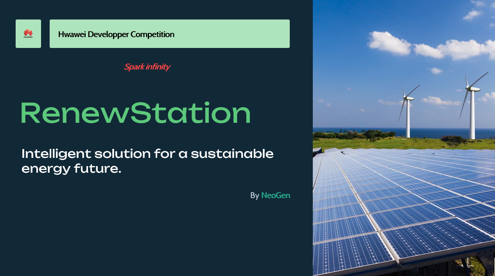
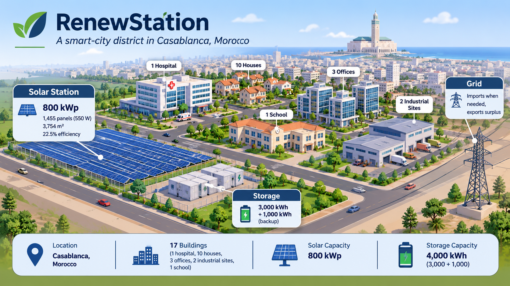
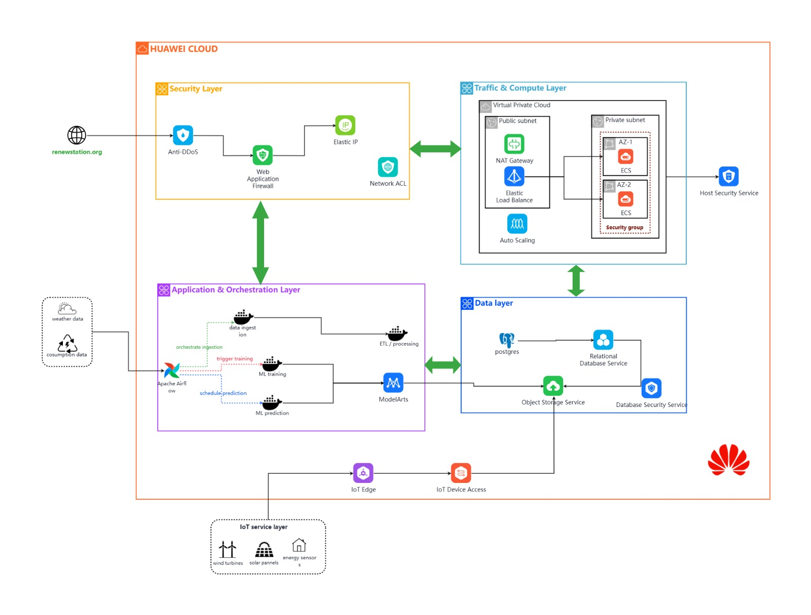
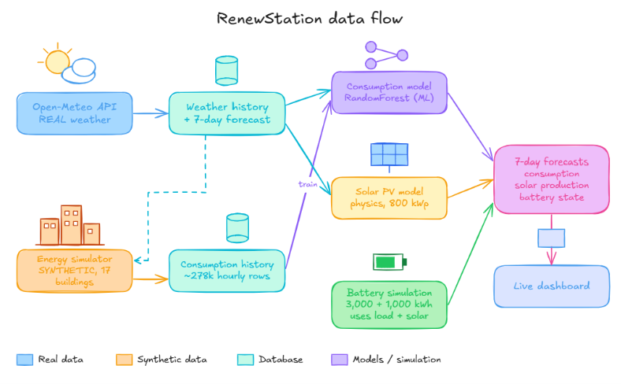

<!-- Competition -->

<!-- Skills -->

 

### $\color{red}{\textbf{\textsf{⛔Usage Notice ⛔}}}$

> This project is **not licensed** and is **not intended for commercial use**. It is shared for **educational and portfolio purposes only**. You may read the code and learn from it, but you may not copy, redistribute or use it in commercial products without permission from the team.

 

## **$\color{#DC2626}{\textbf{\textsf{About}}}$** 

RenewStation was built by **Team NeoGen** for the **Huawei Developer Competition – Spark Infinity**, organized by **HCDG Northern Africa** (Egypt, remote, December 2025).

| Member | Role | GitHub |
|---|---|---|
| **BENSBEH CHAIMAE** | Machine learning model training | [@YOUR_GITHUB](https://github.com/chaibs00) |
| **BJIBJI HAMZA** | ROLE | [@Bjibjihamza](https://github.com/Bjibjihamza) |
| **SGHIOUAR IMANE** | ROLE | [@GITHUB_3](https://github.com/imanesghiouar) |
| **EL AKRAMINE YASSIR SALIM** | ROLE | [@GITHUB_4](https://github.com/SalimYs) |
| **ECHAHLAOUI YOUSSEF** | ROLE | [@GITHUB_5](https://github.com/Yussef31) |

 
Click the image to watch the demo on YouTube

 

## $\color{#EA580C}{\textbf{\textsf{Problem Definition}}}$

Today, the challenge is no longer just generating renewable energy, but `managing its unpredictability` and `balancing production with energy demand`.

For instance, **Solar energy production** depends on sunlight and weather conditions, while consumption varies with people's needs, buildings activity. This mismatch makes it difficult to plan energy usage in advance.

Without accurate forecasting, operators cannot anticipate :
- when the batteries will run empty ?
- how much energy must be bought from the grid ?
- when surplus solar energy will be wasted ?

 

## $\color{#16A34A}{\textbf{\textsf{Overview}}}$

**RenewStation** is an **AI-powered platform for renewable energy optimization**. It **monitors**, **forecasts** and **plans** the energy of a district powered by solar panels and batteries, so operators know in advance how much energy will be **consumed**, **produced** and **stored** over the next **`7 days`**.

The platform combines **real weather data**, a **machine learning model** for consumption, a **physical model** for solar production and a **battery simulation**. 

### $\color{orange}{\textsf{Simulation Setup}}$

For the competition, we built a **simulation of a smart-city district in Casablanca, Morocco**: **`17 virtual buildings`** powered by a **`800 kWp`** solar station with battery storage and connected to the grid. The buildings' consumption is **simulated** from their type, equipment and occupancy, combined with **real weather data**, to reproduce how a real district behaves.

 

| Component | Details |
|---|---|
| **Buildings** | 17 buildings: 1 hospital, 10 houses, 3 offices, 2 industrial sites, 1 school |
| **Solar station** | 800 kWp: 1,455 panels of 550 W, 3,754 m², 22.5% module efficiency |
| **Storage** | Main battery 3,000 kWh + backup battery 1,000 kWh |
| **Grid** | Imports when solar and batteries fall short, exports surplus |

### $\color{orange}{\textsf{Daily Workflow}}$

Every day at midnight, the platform:

1. Pulls **real weather data** and a **7-day forecast**.
2. Forecasts the **hourly energy consumption** of each building for the next **`168 hours`**.
3. Estimates **solar production** from the weather forecast with a physical PV model.
4. Simulates the **battery state of charge** and **grid import/export** hour by hour.
5. Updates the **live dashboard** with all forecasts.

 

## $\color{#16A34A}{\textbf{\textsf{System Architecture}}}$

 

| Component | Role |
|---|---|
| **Airflow** | Orchestrates ingestion, simulation, training and daily predictions |
| **PostgreSQL** | Stores history, live data and 7-day predictions (silver layer) |
| **Node.js API** | Read-only REST API serving the dashboard |
| **React dashboard** | Visualizes consumption, production, battery state and weather |
| **Huawei Cloud (design)** | Designed for ECS, GaussDB and OBS; runs locally with Docker Compose |

 

## $\color{#16A34A}{\textbf{\textsf{Data}}}$

> ⛔
> For **privacy and confidentiality** reasons, **no real-world consumption data** was used in this project. Real data reveals sensitive information about people and buildings (presence, habits, activity), so it could not be shared during the competition.
>
> Instead, **synthetic data** was generated to reproduce how a real district behaves. The **only real data** is the **weather** from **`Open-Meteo`**, and it drives the simulation. All results should be read with this in mind.

### $\color{orange}{\textsf{Data Flow}}$

 

| Source | Type | Description |
|---|---|---|
| **Weather** | `Real` | Hourly temperature, humidity, cloud cover and solar radiation from [Open-Meteo](https://open-meteo.com/) for Casablanca |
| **Building consumption** | `Synthetic` | Hourly load per building, generated from building type, equipment (HVAC, lighting, special equipment), occupancy, holidays and real weather |
| **Solar production** | `Computed` | Physical PV model: radiation, panel area, efficiency, temperature losses, inverter efficiency |
| **Battery state** | `Simulated` | Hour-by-hour charge and discharge with capacity and power limits |

**Dataset size:** about **`278,000` hourly records** (`17` buildings × hourly data since January 2024).

 

## $\color{#16A34A}{\textbf{\textsf{Forecasting}}}$

| Task | Target |
|---|---|
| **Consumption forecasting** | Energy consumed by each of the `17` buildings (kW) | 
| **Production forecasting** | Energy produced by the `800 kWp` solar station (kWh) | 

 

### $\color{orange}{\textsf{Consumption Forecasting}}$

| | |
|---|---|
| **Model** | `RandomForestRegressor` (500 trees), `scikit-learn` pipeline |
| **Weather features** | Temperature, humidity, cloud cover, solar radiation |
| **Time features** | Hour, day of week, month, day of year, weekend, holiday, peak hour, season |
| **Building feature** | Building name (one-hot encoded) |
| **Preprocessing** | `StandardScaler` on numeric features, `OneHotEncoder` on building |
| **Retraining** | Daily, through the `retrain_model` Airflow DAG |

 

### $\color{orange}{\textsf{Production Forecasting}}$

Solar output is computed directly from the **7-day weather forecast** :

| | |
|---|---|
| **Input** | Forecast solar radiation (W/m²) and temperature |
| **Panels** | `3,754 m²`, `22.5%` module efficiency, `800 kWp` peak |
| **Losses** | Cell temperature (NOCT `45°C`, `-0.4%/°C`), inverter efficiency `97%` |
| **Output** | Hourly production (kWh), capped at peak power |

 

## $\color{#16A34A}{\textbf{\textsf{Results}}}$

Results of the consumption model, as presented at the competition:

| Metric | Value |
|---|---|
| **MAE** | `0.149 kW` |
| **RMSE** | `0.285 kW` |
| **R²** | `0.998` |
| **Training data** | `~278,000` hourly records, `17` buildings |
| **Split** | Random 80/20 train/test |

### $\color{orange}{\textsf{Interpretation}}$

- **MAE `0.149 kW`:** on average, each hourly prediction is off by about **150 W**, roughly the consumption of **a few light bulbs**. That's small next to buildings that consume several kW per hour.
- **RMSE `0.285 kW`:** RMSE is about **twice the MAE**, so most errors are small but a few hours have **larger errors**, most likely during **consumption peaks** (sudden HVAC or industrial loads).
- **R² `0.998`:** the model explains **99.8%** of the variation in consumption. It has learned the main patterns well: **daily cycles**, **weekends and holidays**, **building type** and the **effect of the weather**.

 

## $\color{#0284C7}{\textsf{Pipelines}}$

| DAG | Schedule | What it does |
|---|---|---|
| `initialization` | Manual, run once | Loads weather history, generates consumption history, sets batteries to 100% |
| `daily_prediction` | Daily, 00:00 | Archives yesterday, updates real battery state, fetches 7-day weather, predicts consumption, solar and battery for 7 days |
| `retrain_model` | Daily, 00:00 | Retrains the consumption model on the latest data |

 

## $\color{red}{\textbf{\textsf{Credits}}}$

All credit goes to **Team NeoGen**, who designed and built RenewStation for the **Huawei Developer Competition – Spark Infinity** (HCDG Northern Africa, 2025), where it won the **4th place Innovation Award**. 

- **Weather data:** [Open-Meteo](https://open-meteo.com/)

